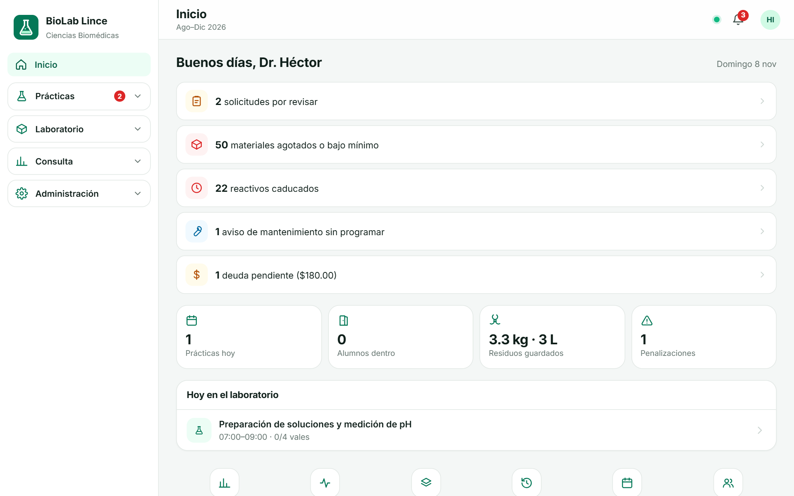
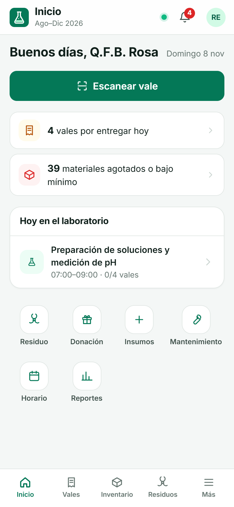
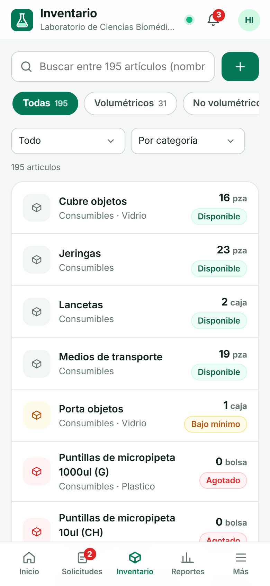
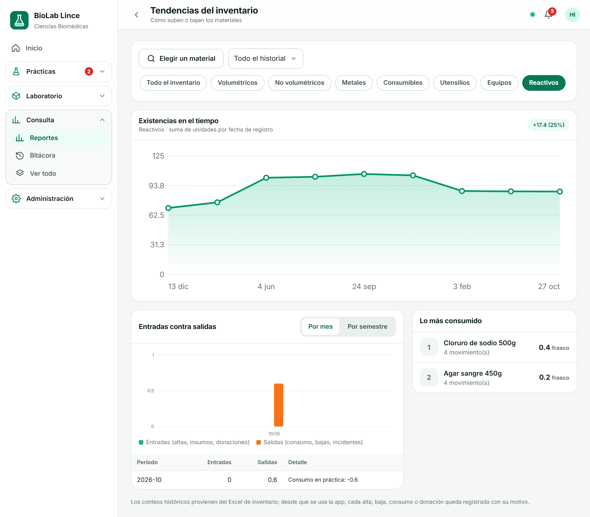

# 🧪 BioLab Lince

**Sistema de gestión para laboratorios de ciencias biomédicas**

Inventario, prácticas, vales de material con QR, residuos RPBI y mantenimiento, en tiempo real, desde el celular o la computadora.

---

## Sobre el proyecto

BioLab Lince digitaliza la operación diaria de un laboratorio escolar de ciencias biomédicas. Reemplaza las bitácoras en papel, los vales impresos y las hojas de cálculo de inventario por una sola aplicación que todos los involucrados usan desde su celular o su computadora, y que se actualiza al instante para todos.

El sistema aplica automáticamente las reglas del reglamento del laboratorio: anticipación mínima para solicitar prácticas, horario de servicio, material disponible, penalizaciones y bloqueos por semestre.

## Funciones principales

| Rol | Qué puede hacer |
|---|---|
| **Coordinación** | Autoriza o rechaza solicitudes de práctica con validación automática de material, horario y equipos; programa mantenimientos y recolecciones de residuos; consulta reportes, tendencias e historial completo. |
| **Laboratorio** | Entrega material escaneando el QR del vale, con foto obligatoria como evidencia; recibe devoluciones; registra altas, bajas, donaciones y residuos. |
| **Profesores** | Registran sus equipos por semestre, solicitan prácticas eligiendo entre cientos de materiales, pasan lista con código QR, firman la limpieza y reportan incidentes. |
| **Alumnos** | Registran su entrada con QR, consultan su vale, sus deudas y penalizaciones, y saben en todo momento cuándo pueden salir. |

**Además:**

- ⚡ **Tiempo real:** los cambios aparecen al instante para todos, sin recargar.
- 🔔 **Notificaciones push:** avisos de autorizaciones, entregas, deudas y recordatorios, aunque la app esté cerrada.
- 📱 **Instalable:** funciona como app en celular y en computadora (PWA).
- 🧾 **Vales digitales con QR** con el formato oficial del laboratorio, listos para imprimir.
- 📊 **Reportes imprimibles y exportables** a Excel, gráficas de existencias por fecha o semestre.
- 🗂️ **Bitácora completa:** qué pasó, cuándo, quién y por qué.
- ☣️ **Control de residuos RPBI** y **mantenimiento de instrumentos**, con facturas y comprobantes.
- 🔒 **Seguro:** permisos por rol, contraseñas cifradas, protección contra ataques comunes y archivos internos inaccesibles.

## Capturas

Panel de coordinación: solo lo que requiere atención, con el menú agrupado en cajas desplegables.

  

&nbsp;&nbsp;

En el celular: inicio del laboratorio e inventario con buscador y filtros.

  

Tendencias: cómo suben o bajan los materiales por fecha o semestre.

## Tecnología

PHP 8 · MySQL / MariaDB · JavaScript moderno sin frameworks · Server-Sent Events · Web Push (VAPID) · Service Worker / PWA

## 🔐 Acceso al código fuente

El código fuente de BioLab Lince **no es público**. Este repositorio solo presenta el proyecto.

Si te interesa el sistema, una licencia de uso o una demostración, **solicítalo por correo** explicando quién eres y para qué lo necesitas:

📧 **[corpjh@proton.me](mailto:corpjh@proton.me)**

---

© 2026 <a href="https://corpjh.com">CorpJH</a>. Todos los derechos reservados. Software propietario: queda prohibida su copia, modificación o distribución sin autorización por escrito.

